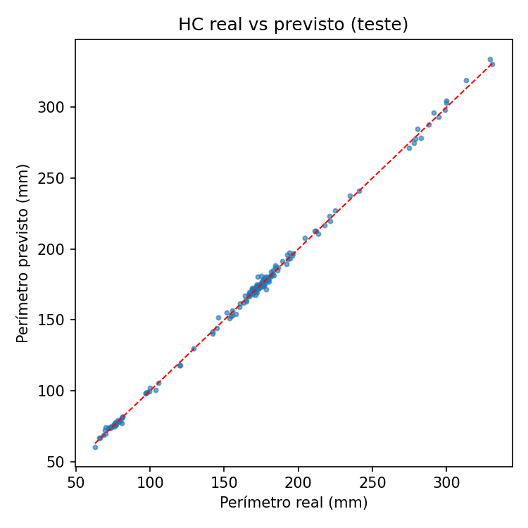
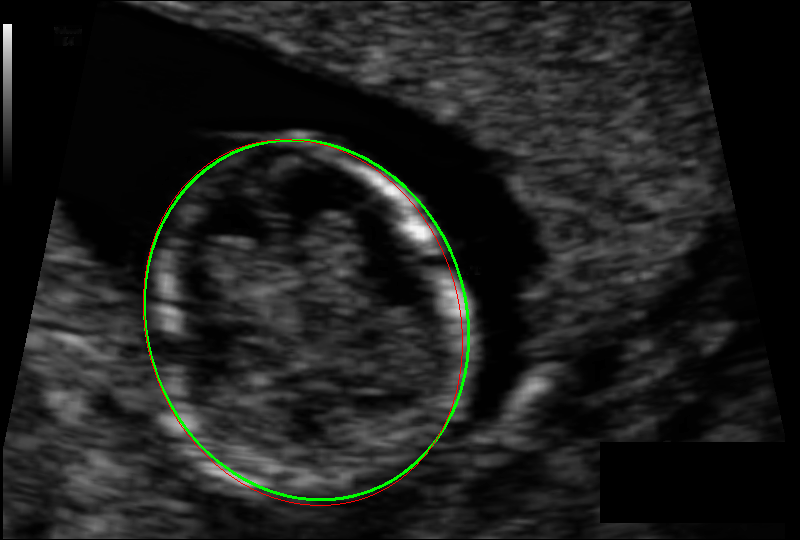
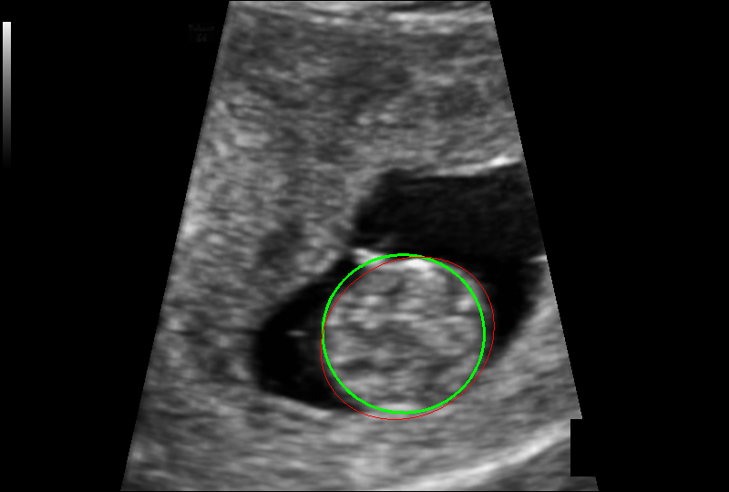

# Fetal head segmentation in ultrasound images (HC18)

A personal project on AI for fetal medical imaging: given an ultrasound image,
segment the fetal head and estimate the head circumference (HC) in millimetres.
Automatic biometry like this is a common task in fetal ultrasound analysis.

## Data

The HC18 dataset (Zenodo / Grand Challenge): 999 ultrasound images with the fetal
head annotated, plus the pixel size of each image. The official test set has no
public annotations, so evaluation uses a split made from the training set. Check
the dataset's license and terms of use before redistributing any part of it.

The split is done **by patient**, so no patient appears in more than one set:

| Set | Images | Patients |
|---|---|---|
| Train | 696 | 564 |
| Validation | 149 | 121 |
| Test | 154 | 121 |

## Method

- Masks are obtained by filling in the annotated elliptical outline.
- U-Net with an ImageNet-pretrained ResNet34 encoder, 1 input channel, built with `segmentation_models_pytorch`.
- Images are resized to 352×512. Augmentation: horizontal flip, small rotation/scale/shift, brightness and contrast changes.
- Dice + BCE loss, AdamW (lr 3e-4), cosine annealing, 40 epochs, batch size 8, Apple GPU (MPS). The model is chosen by validation Dice.
- Post-processing: keep the largest connected component, fit an ellipse (OpenCV), compute its perimeter with Ramanujan's approximation, and convert to mm using each image's pixel size.

## How to run

1. `python src/prepare_data.py --raw data/raw --out data/processed`
2. `python src/train.py --epochs 40`
3. `python src/evaluate.py`

Dependencies are in `requirements.txt`. The dataset goes in `data/raw/`
(`training_set/` and `training_set_pixel_size_and_HC.csv`).

## Results

Evaluated on 154 test images, never seen during training or model selection:

| Metric | Value |
|---|---|
| Mean Dice | 0.9765 |
| Mean absolute HC error | 1.71 mm |
| Median absolute HC error | 1.30 mm |
| Mean relative error | 1.09 % |
| Images with error ≤ 2 mm | 64.9 % |
| Images with error ≤ 5 mm | 96.1 % |

Worst case: a 7.6 mm error (true HC 172.7 mm). Figures (green = predicted, red = annotated):

A typical case and one of the hardest (lowest Dice):

`evaluate.py` generates these figures (and more examples) in `results/`.

## Limitations

- A single dataset from a single acquisition context, with no external or clinical validation.
- Results come from one split and one training run (no cross-validation and no repeated seeds), so run-to-run variation was not measured.
- The official HC18 test set has no public annotations, so these numbers are not directly comparable with the official challenge leaderboard.
- No analysis by gestational age or image quality.
- The perimeter assumes the head is well approximated by an ellipse.
- This is an exercise on public data, not a clinical tool.

## Note on development

The code was written with the help of an AI assistant (Claude). I ran the training
and evaluation myself on my own machine.
